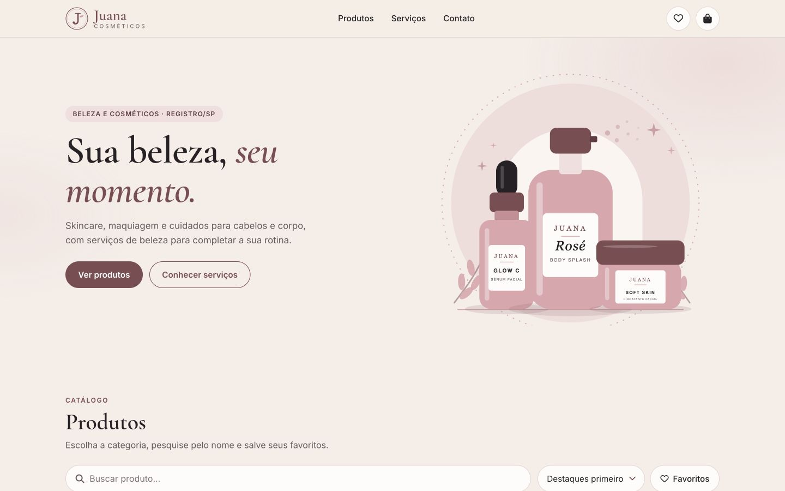
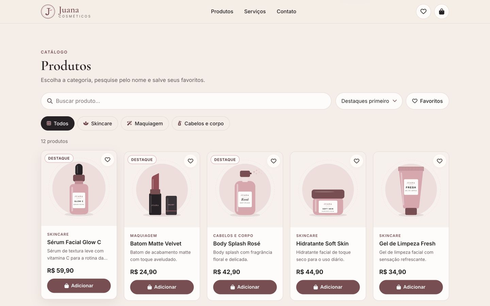
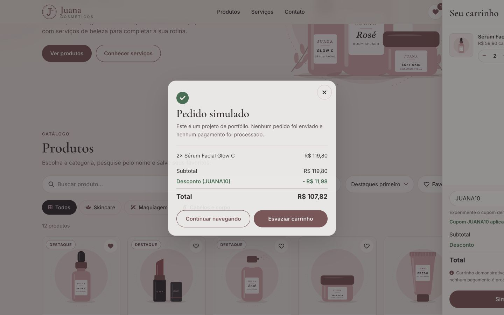

# Juana Cosméticos — Catálogo Digital

Projeto demonstrativo de portfólio de **Rainer Zambrano**, com uma marca fictícia de cosméticos. A proposta é apresentar a personalização de uma interface e a adaptação de um catálogo existente usando HTML, CSS e JavaScript.

> Marca, produtos, preços, serviços e contatos são fictícios. O carrinho apenas simula um pedido; não há pagamento, envio de mensagens nem agendamento.

**Status:** publicado no GitHub Pages. Testes de armazenamento e publicação concluídos com sucesso em 18/11/2026.

**[Acessar a demonstração online](https://rainerzambrano.github.io/Juana-Cosmetico-catalogo/)**



## Sobre o projeto

O catálogo apresenta uma identidade em creme, rosé e vinho, tipografia Cormorant Garamond e Inter, monograma e ilustrações de produtos em SVG. A organização permite explorar categorias, buscar itens e experimentar um carrinho demonstrativo.

O trabalho parte do projeto [RA Cosméticos](https://github.com/ronaldandrade25/ra-cosmetico), publicado pela conta [@ronaldandrade25](https://github.com/ronaldandrade25), e foi personalizado no contexto de estudos da mentoria **Operação 50K, do DevClub**. A apresentação demonstra a adaptação da base para uma identidade fictícia. É um portfólio pessoal de Rainer, sem caráter de produto oficial do DevClub ou de entrega a um cliente real.

## Funcionalidades presentes

- 12 produtos fictícios em Skincare, Maquiagem e Cabelos e corpo.
- Busca que desconsidera acentos e diferenças entre maiúsculas e minúsculas.
- Filtros por categoria e favoritos; ordenação por destaque, preço e nome.
- Favoritos e carrinho salvos no navegador.
- Janela de detalhes com descrição, modo de uso e quantidade.
- Carrinho com alteração de quantidade, remoção de itens e cupom demonstrativo `JUANA10`.
- Resumo de pedido simulado, sem transmissão dos dados do carrinho.
- Cinco serviços fictícios, sem agendamento.
- Layout adaptável, barra de carrinho no celular e controles de teclado.

## Tecnologias

| Camada | Recursos |
| --- | --- |
| Estrutura | HTML5 e `<dialog>` |
| Apresentação | CSS, Grid, Flexbox, variáveis e media queries |
| Interações | JavaScript, eventos e manipulação do DOM |
| Persistência | `localStorage` para favoritos e carrinho |
| Dados e imagens | Arquivo JavaScript local e ilustrações SVG |
| Tipografia e ícones | Google Fonts e Font Awesome Free 6.5.1 via CDN |
| Publicação | GitHub Pages com GitHub Actions |

O catálogo não exige framework, instalação de pacotes ou compilação para funcionar. Fontes e ícones dependem de serviços externos; as ilustrações e os dados dos produtos são locais.

## Capturas de tela

Capturas reais da prévia local revisada em 18/11/2026.

| Catálogo no computador | Visualização móvel |
| --- | --- |
|  |  |



## Origem e personalização

| Parte | Descrição |
| --- | --- |
| Base recebida | [RA Cosméticos](https://github.com/ronaldandrade25/ra-cosmetico), da conta [@ronaldandrade25](https://github.com/ronaldandrade25), utilizado nos estudos da mentoria Operação 50K, do DevClub. |
| Versão de portfólio | Personalização apresentada por Rainer Zambrano para Juana Cosméticos: identidade visual, textos, produtos e contexto demonstrativo. |
| Preparação desta entrega | Revisão com assistência do ChatGPT/Codex: correção do armazenamento local, ajuste para telas de 320 px, organização, documentação, capturas, testes e preparação do Pages. |
| Administração com Firebase | Código opcional da base, preservado em `extras/firebase/`. Não integra a demonstração publicada e não foi validado com banco real. |

A lista de funcionalidades descreve esta versão; não atribui a implementação original de todos os recursos a Rainer. Consulte [origem e licenciamento](docs/ORIGEM-E-LICENCA.md) e [créditos de terceiros](docs/CREDITOS.md).

## Executar localmente

Com Python 3 instalado, abra um terminal na pasta do projeto:

```bash
python3 -m http.server 5500
```

Abra [http://localhost:5500](http://localhost:5500). Também é possível usar a extensão Live Server do VS Code. Mantenha `firebase-config.js` vazio para usar os dados fictícios; nenhum login é necessário.

## Organização

| Caminho | Conteúdo |
| --- | --- |
| `index.html` | Página do catálogo |
| `style.css` | Identidade visual e responsividade |
| `script.js` | Busca, filtros, favoritos, detalhes e carrinho |
| `data/catalogo-demo.js` | Produtos, categorias, serviços e cupom |
| `assets/` | Monograma, favicon e ilustrações |
| `firebase-config.js` | Configuração vazia para o modo local |
| `docs/` | Capturas, origem, créditos e registro da revisão |
| `extras/firebase/` | Administração e carga de dados da base, fora do site público |
| `scripts/preparar-pages.py` | Prepara somente os arquivos públicos |
| `tests/storage.test.mjs` | Testes do tratamento de armazenamento |
| `.github/workflows/pages.yml` | Publicação no GitHub Pages a cada alteração em main ou execução manual |

## Verificação e publicação

A revisão local cobriu os fluxos principais, os caminhos de imagens e scripts e telas de 320, 390, 768 e 1440 px. Consulte [o registro dos testes e seus limites](docs/REVISAO.md).

Teste de armazenamento, com Node.js:

```bash
node tests/storage.test.mjs
```

Preparação da pasta `public/`:

```bash
python3 scripts/preparar-pages.py
```

O comando copia somente a página, os estilos, os scripts, os dados e as ilustrações. Painel, carga de dados, documentos e histórico Git ficam fora do site.

O repositório utiliza **GitHub Actions** como origem em **Settings → Pages**. O workflow **Publicar catálogo demonstrativo** verifica o armazenamento, prepara os arquivos públicos e faz o deploy a cada alteração em `main`. Também pode ser iniciado manualmente na aba **Actions**.

## Licenciamento

Não foi encontrada uma licença geral da base no material recebido ou no repositório original consultado em 18/11/2026. Este portfólio preserva a atribuição e os direitos de terceiros e não acrescenta uma licença MIT ou outra licença aberta ao conjunto. A disponibilização para demonstração não constitui uma nova autorização de reutilização ou comercialização do código original.

O contexto informado para a publicação está registrado em [origem e licenciamento](docs/ORIGEM-E-LICENCA.md). Fontes e ícones têm licenças próprias, indicadas nos [créditos](docs/CREDITOS.md).

## Responsável pela personalização

**Rainer Zambrano** — projeto de estudo e portfólio pessoal.

[Site pessoal](https://rainerzambrano.com)
